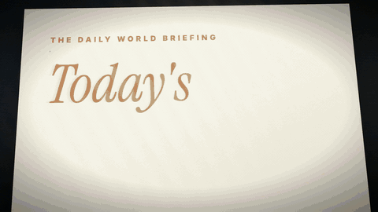

# YouTube News Video

A Claude skill that produces a complete **YouTube news episode** in two phases: it researches the day's stories and writes the scripts, then voices them (with your ElevenLabs key, or your own recordings) and turns them into a cinematic, physically lit animated video, plus 2 Shorts and a thumbnail.

## See it in action

[](docs/demo/tech_briefing_demo.mp4)

**[▶ Watch the full 1-minute episode (720p, with sound)](docs/demo/tech_briefing_demo.mp4)**

A test run from 16 November 2026, made end to end by the skill from one request ("a one-minute tech news for today", no Shorts):

- **Research:** three tech stories from the last 48 hours (Nvidia's leadership search, a Vulcan rocket lost with 40 Amazon Leo satellites, a 10-nation AI supply-chain pact), each checked against at least two reputable sources or an official primary source.
- **Voice:** five clips recorded through the ElevenLabs API and checked with Whisper (every clip matched its script on the first take).
- **Animation:** the "Cinematic Desk" look in Remotion and Three.js: news briefs under window-blind light, kinetic headlines with motion trails, keyword ticks on the spoken word, a quote card, big numbers, a lit globe, and paper-plane flights through the giant 3D "TECH" letters between stories.
- **Sound and checks:** sound design and a music bed mixed to −14 LUFS; an automatic scan of every frame for blank, dark or flashing frames (0 failures).
- No footage and no photos: this run went ahead without uploaded images, so every frame is code-built graphics.

## What it does

**Phase 1: research and writing**
- Asks how long the episode should be (about 2, 5 or 8-12 minutes, or your own length).
- Researches the latest stories and checks them against sources.
- Writes ElevenLabs voice scripts with set clip names, so the audio drops straight into Phase 2.
- Writes the YouTube title, description, chapters and tags.
- Gives an image wish list per story and asks whether you'll upload images (photos of real people are fine) or want it to go ahead with code-built graphics only.
- Asks whether you have a reference animation you'd like any part to move like (intro, transitions, headline reveal, Shorts hook).

**Phase 2: voice and build**
- Voices the narration your way: through the ElevenLabs API with your key (it shows you how to add the key), from clips you record in ElevenLabs yourself (with step-by-step instructions), or free on your own computer with Kokoro, an open-source voice (setup for Mac with Apple Silicon or Intel, Windows and Linux; on Android it explains the options). Every clip is checked with Whisper, and the finished video is checked for voice-to-picture sync.
- **"Cinematic Desk" look:** each story is a printed news brief lying on a dark desk, under a warm window light whose blind shadows drift slowly across the scene.
- **Type and motion:** kinetic serif headlines with motion trails, keyword checklists that tick on the beat, a slow camera dolly and paper-plane transitions between stories.
- **Category colours:** World, Tech, Business, Sports and Breaking, with a consistent brand (intro sting, outro, sign-on and sign-off lines).
- **Sound and checks:** a sound-design pass, a −14 LUFS mix, and quality checks before delivery.
- **Reference matching:** a reference you send is measured frame by frame (timing, easing, overshoot) and rebuilt in the channel's own look, then compared until every move is within ±0.08 s.
- **Hero checklists:** the intro, paper-plane transition, category worlds, outro, thumbnail and Shorts hooks are each graded against a measurable checklist.
- **Photos:** images you upload appear as lit prints in the 3D world, with a credit line and name caption.
- **Delivery:** the long-form video, 2 vertical Shorts and a thumbnail.

## What you can build with it

- **Daily or weekly news briefings:** "Today's Briefing", 3-5 stories, 2-5 minutes.
- **Topic roundups:** tech news of the week, sports weekend recap, business headlines.
- **Breaking-news Shorts:** one story, vertical, under 60 s.
- **A regional channel:** stories picked for a specific country or audience, in its own brand colours.

## Installing

**Standalone:** the skill carries its own build engine. `references/engine.md` is a news-only build manual, bundled with its scripts and reference files, and the rendering, typography and chart rules are written into `SKILL.md`, so no other skill is needed.

**Claude apps:** zip `skills/youtube-news-video` and upload it under *Customize → Skills* (or add this folder as a plugin).

**Claude Code:**

```bash
cp -R skills/youtube-news-video ~/.claude/skills/
```

## Requirements

- Node.js 18+, Remotion and Three.js (the project is created by the skill; see `references/engine.md`), FFmpeg, and Python 3 with `faster-whisper`, `librosa` and `soundfile`.
- For the voice, one of: an ElevenLabs API key in the project's `keys.env`, your own ElevenLabs recordings, or the free Kokoro voice (`pip install kokoro soundfile` and `brew install espeak-ng`; the skill asks before installing).
- Web search, for the research phase.

## How to use it

```text
Make today's news episode: 4 world and tech stories, about 3 minutes.
```

Phase 1 ends with the scripts and metadata, and asks how to voice them: ElevenLabs with your key, your own ElevenLabs recordings, or the free Kokoro voice. If you record the clips yourself, it gives you the steps and file names, then:

```text
Here are the audio clips for today's episode. Build the video and the 2 Shorts.
```

## Brand

The brand section in `SKILL.md` has placeholders: the channel name, palette, category accents, fonts, intro/outro, sign-on and sign-off. Fill them in once, and every episode stays consistent.

## Repository layout

```
skills/youtube-news-video/
  SKILL.md               phases, brand, house rules (rendering, typography, charts), Cinematic Desk
                         motion style, sound design, build and final checks
  references/
    engine.md            bundled build engine: setup, timing, camera library, Three.js rules,
                         preview → final, sound and mix, Shorts, captions, quality checks
    camera_bible.md, director.md, hero_checklist.md, living_motion.md,
    reference_matching.md, subframe_accumulation.md
  scripts/
    render_scan.py, beat_sheet.py, check_shotlist.py, check_palette.py, check_frames.py,
    cam_track.mjs, eleven_voice.py, sync_check.py, eleven_sfx.py, ref_frames.py, track_motion.py, fit_easing.py,
    motion_compare.py
```
